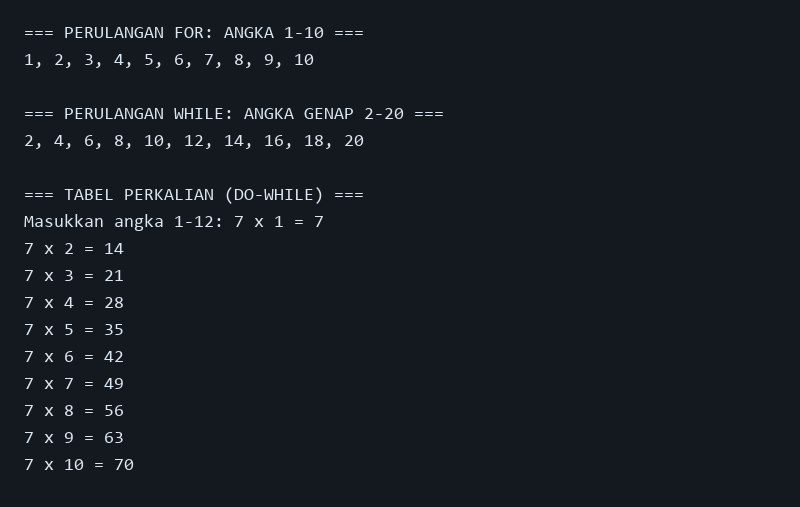
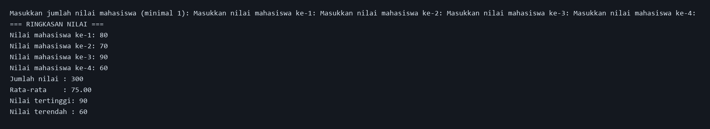
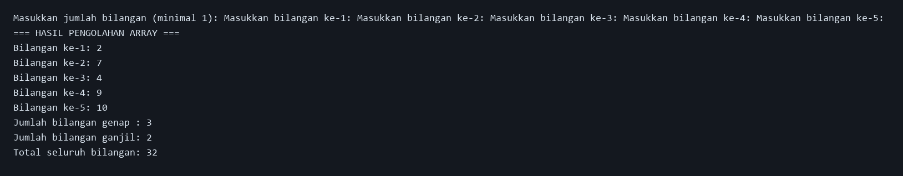

# Jobsheet 6 — Looping dan Array

**Mata kuliah:** Praktikum Pemrograman Java  
**Nama:** [Isi nama] · **NIM:** [Isi NIM] · **Kelas:** [Isi kelas]

## Tujuan Pembelajaran
1. Memahami perulangan `for`, `while`, dan `do-while`.
2. Menggunakan array satu dimensi untuk menyimpan data.
3. Mengolah data dengan perulangan, termasuk menghitung total, rata-rata, dan kategori bilangan.

## Ringkasan Materi
Looping/perulangan menjalankan instruksi berulang kali. `for` cocok saat jumlah pengulangan diketahui, `while` mengulang selama kondisi benar, dan `do-while` menjalankan isi setidaknya satu kali sebelum memeriksa kondisi. Array menyimpan sejumlah nilai bertipe sama dalam satu variabel; indeks array dimulai dari 0. Perulangan memudahkan program membaca dan mengolah setiap elemen array.

## Program A — TugasLooping.java
Menampilkan angka 1–10 dengan `for`, angka genap 2–20 dengan `while`, lalu tabel perkalian angka pilihan (1–12) dengan `do-while`.

**Contoh input:** `7`  
**Contoh output inti:** angka 1 sampai 10; genap 2 sampai 20; tabel `7 x 1 = 7` hingga `7 x 10 = 70`.



## Program B — TugasArray.java
Meminta jumlah nilai mahasiswa (minimal satu), mengisi array `int`, lalu menampilkan seluruh nilai, jumlah, rata-rata, nilai tertinggi, dan nilai terendah.

**Contoh input:** jumlah `4`, lalu nilai `80`, `70`, `90`, `60`.  
**Output inti:** jumlah `300`, rata-rata `75.00`, tertinggi `90`, terendah `60`.



## Program C — TugasLoopingArray.java
Meminta beberapa bilangan, menyimpannya dalam array, menampilkan isinya, dan menghitung banyak bilangan genap/ganjil serta totalnya.

**Contoh input:** jumlah `5`, lalu `2`, `7`, `4`, `9`, `10`.  
**Output inti:** genap `3`, ganjil `2`, total `32`.



## Kompilasi dan Menjalankan (Windows)
Pastikan JDK telah terpasang. Buka Command Prompt, lalu jalankan:

```bat
cd /d D:\learningjava\Jobsheet6
javac -d out src\TugasLooping.java src\TugasArray.java src\TugasLoopingArray.java
java -cp out TugasLooping
java -cp out TugasArray
java -cp out TugasLoopingArray
```

Masing-masing perintah `java` menjalankan program terpisah. Masukkan data sesuai prompt. Ketiga program menolak input non-angka dan meminta ulang; program array juga meminta jumlah data minimal 1.

## Kesimpulan
Array menjadi tempat penyimpanan banyak data sejenis, sedangkan looping membantu mengisi, menampilkan, dan mengolah seluruh data tersebut tanpa menulis instruksi yang sama berulang kali. Keduanya merupakan dasar penting dalam pembuatan program pengolahan data.

## Catatan Output
Gambar pada folder `image` adalah tampilan output uji yang dirender dari hasil eksekusi program yang benar-benar dijalankan (bukan tangkapan layar desktop). Output teks mentah juga disertakan dengan nama yang sama berekstensi `.txt` untuk pemeriksaan.


---

# Kode Program dan Output Lengkap (Copy-Paste)

Salin kode tiap bagian ke file dengan nama yang sama di folder `src`. Output berikut adalah hasil uji program dengan contoh input yang dicantumkan.

## Program A — `TugasLooping.java`

### Kode sumber (siap disalin)
```java
import java.util.Scanner;

public class TugasLooping {
    public static void main(String[] args) {
        Scanner input = new Scanner(System.in);

        System.out.println("=== PERULANGAN FOR: ANGKA 1-10 ===");
        for (int angka = 1; angka <= 10; angka++) {
            System.out.print(angka + (angka < 10 ? ", " : "\n"));
        }

        System.out.println("\n=== PERULANGAN WHILE: ANGKA GENAP 2-20 ===");
        int genap = 2;
        while (genap <= 20) {
            System.out.print(genap + (genap < 20 ? ", " : "\n"));
            genap += 2;
        }

        System.out.println("\n=== TABEL PERKALIAN (DO-WHILE) ===");
        int angkaPerkalian;
        do {
            System.out.print("Masukkan angka 1-12: ");
            while (!input.hasNextInt()) {
                System.out.print("Input harus berupa bilangan bulat. Masukkan lagi: ");
                input.next();
            }
            angkaPerkalian = input.nextInt();
            if (angkaPerkalian < 1 || angkaPerkalian > 12) {
                System.out.println("Angka harus berada di antara 1 dan 12.");
            }
        } while (angkaPerkalian < 1 || angkaPerkalian > 12);

        int pengali = 1;
        do {
            System.out.println(angkaPerkalian + " x " + pengali + " = " + (angkaPerkalian * pengali));
            pengali++;
        } while (pengali <= 10);

        input.close();
    }
}
```

### Contoh output (siap disalin)
```text
=== PERULANGAN FOR: ANGKA 1-10 ===
1, 2, 3, 4, 5, 6, 7, 8, 9, 10

=== PERULANGAN WHILE: ANGKA GENAP 2-20 ===
2, 4, 6, 8, 10, 12, 14, 16, 18, 20

=== TABEL PERKALIAN (DO-WHILE) ===
Masukkan angka 1-12: 7 x 1 = 7
7 x 2 = 14
7 x 3 = 21
7 x 4 = 28
7 x 5 = 35
7 x 6 = 42
7 x 7 = 49
7 x 8 = 56
7 x 9 = 63
7 x 10 = 70
```

## Program B — `TugasArray.java`

### Kode sumber (siap disalin)
```java
import java.util.Scanner;

public class TugasArray {
    public static void main(String[] args) {
        Scanner input = new Scanner(System.in);
        int jumlahData;

        // Pastikan jumlah data minimal satu.
        do {
            System.out.print("Masukkan jumlah nilai mahasiswa (minimal 1): ");
            while (!input.hasNextInt()) {
                System.out.print("Masukkan bilangan bulat. Coba lagi: ");
                input.next();
            }
            jumlahData = input.nextInt();
            if (jumlahData < 1) System.out.println("Jumlah data harus minimal 1.");
        } while (jumlahData < 1);

        int[] nilai = new int[jumlahData];
        int total = 0;
        int tertinggi = Integer.MIN_VALUE;
        int terendah = Integer.MAX_VALUE;

        for (int i = 0; i < nilai.length; i++) {
            System.out.print("Masukkan nilai mahasiswa ke-" + (i + 1) + ": ");
            while (!input.hasNextInt()) {
                System.out.print("Nilai harus bilangan bulat. Masukkan lagi: ");
                input.next();
            }
            nilai[i] = input.nextInt();
            total += nilai[i];
            if (nilai[i] > tertinggi) tertinggi = nilai[i];
            if (nilai[i] < terendah) terendah = nilai[i];
        }

        double rataRata = (double) total / nilai.length;
        System.out.println("\n=== RINGKASAN NILAI ===");
        for (int i = 0; i < nilai.length; i++) {
            System.out.println("Nilai mahasiswa ke-" + (i + 1) + ": " + nilai[i]);
        }
        System.out.println("Jumlah nilai : " + total);
        System.out.printf("Rata-rata    : %.2f%n", rataRata);
        System.out.println("Nilai tertinggi: " + tertinggi);
        System.out.println("Nilai terendah : " + terendah);
        input.close();
    }
}
```

### Contoh output (siap disalin)
```text
Masukkan jumlah nilai mahasiswa (minimal 1): Masukkan nilai mahasiswa ke-1: Masukkan nilai mahasiswa ke-2: Masukkan nilai mahasiswa ke-3: Masukkan nilai mahasiswa ke-4: 
=== RINGKASAN NILAI ===
Nilai mahasiswa ke-1: 80
Nilai mahasiswa ke-2: 70
Nilai mahasiswa ke-3: 90
Nilai mahasiswa ke-4: 60
Jumlah nilai : 300
Rata-rata    : 75.00
Nilai tertinggi: 90
Nilai terendah : 60
```

## Program C — `TugasLoopingArray.java`

### Kode sumber (siap disalin)
```java
import java.util.Scanner;

public class TugasLoopingArray {
    public static void main(String[] args) {
        Scanner input = new Scanner(System.in);
        int jumlahData;
        do {
            System.out.print("Masukkan jumlah bilangan (minimal 1): ");
            while (!input.hasNextInt()) {
                System.out.print("Masukkan bilangan bulat. Coba lagi: ");
                input.next();
            }
            jumlahData = input.nextInt();
            if (jumlahData < 1) System.out.println("Jumlah data harus minimal 1.");
        } while (jumlahData < 1);

        int[] bilangan = new int[jumlahData];
        int total = 0;
        int jumlahGenap = 0;
        int jumlahGanjil = 0;

        for (int i = 0; i < bilangan.length; i++) {
            System.out.print("Masukkan bilangan ke-" + (i + 1) + ": ");
            while (!input.hasNextInt()) {
                System.out.print("Input harus bilangan bulat. Masukkan lagi: ");
                input.next();
            }
            bilangan[i] = input.nextInt();
            total += bilangan[i];
            if (bilangan[i] % 2 == 0) jumlahGenap++;
            else jumlahGanjil++;
        }

        System.out.println("\n=== HASIL PENGOLAHAN ARRAY ===");
        for (int i = 0; i < bilangan.length; i++) {
            System.out.println("Bilangan ke-" + (i + 1) + ": " + bilangan[i]);
        }
        System.out.println("Jumlah bilangan genap : " + jumlahGenap);
        System.out.println("Jumlah bilangan ganjil: " + jumlahGanjil);
        System.out.println("Total seluruh bilangan: " + total);
        input.close();
    }
}
```

### Contoh output (siap disalin)
```text
Masukkan jumlah bilangan (minimal 1): Masukkan bilangan ke-1: Masukkan bilangan ke-2: Masukkan bilangan ke-3: Masukkan bilangan ke-4: Masukkan bilangan ke-5: 
=== HASIL PENGOLAHAN ARRAY ===
Bilangan ke-1: 2
Bilangan ke-2: 7
Bilangan ke-3: 4
Bilangan ke-4: 9
Bilangan ke-5: 10
Jumlah bilangan genap : 3
Jumlah bilangan ganjil: 2
Total seluruh bilangan: 32
```
